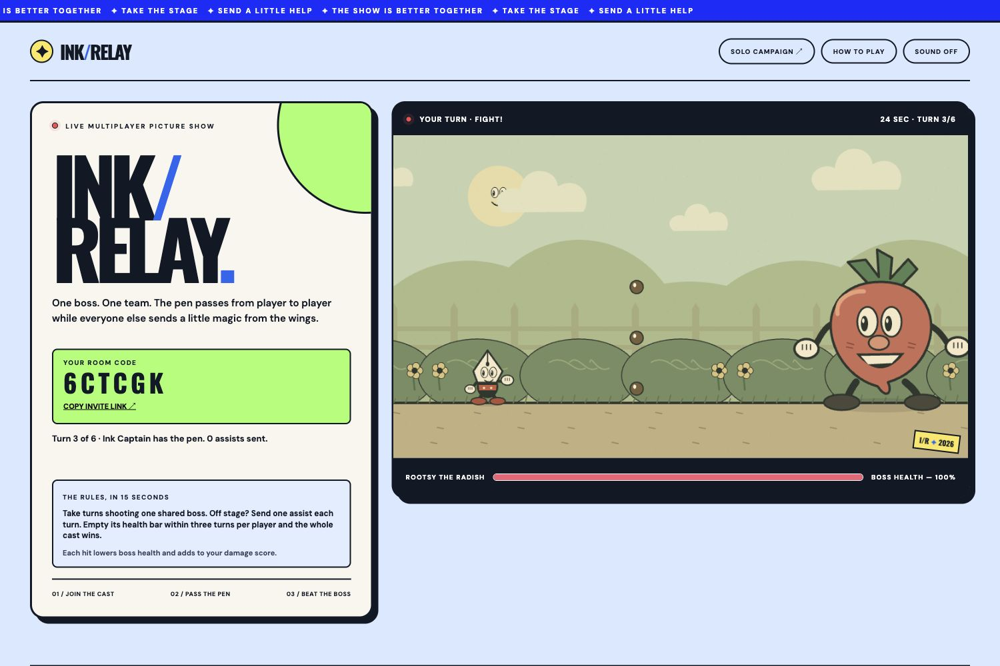

# Ink Relay

**One boss. One team. Pass the pen.** Ink Relay is a cooperative cartoon boss fight for 2–8 people playing together from separate phones or computers. It adapts the original [Ink & Trouble solo campaign](docs/SOLO_CAMPAIGN.md) into a live room game with shared boss health and spectator assists.

[**Play the public game**](https://ink-relay-picture-show.amar12356.chatgpt.site/ink-relay/relay) · [View the cover screenshot](docs/ink-relay-cover.jpg)



## How to play

1. Enter a stage name, choose one of three bosses, and create a room. Share the invite link or six-character code with one to seven friends. No login or installation is required.
2. The host starts when at least two players have joined. Players take 35-second turns fighting the same boss. Damage carries over between turns, and each player's damage score shows their contribution.
3. Players waiting in the wings watch the live fight and can send **one** shield, heart, or super-meter assist per turn.
4. Empty the boss's health bar within **three turns per player** and everyone wins. If the team runs out of turns, the boss wins. The host can start a rematch.

The game explains these rules on its entry screen and provides a detailed **How to Play** dialog. The boss's health bar, turn timer, active player, room roster, and damage scores update across devices.

### Controls

| Action | Keyboard | Phone or tablet |
| --- | --- | --- |
| Move / aim | Arrows or WASD | On-screen arrows |
| Jump | Space | JUMP |
| Fire | Hold Z | FIRE |
| Dash | X | DASH |
| Parry pink shots | C | PARRY |
| EX attack | F | EX |
| Super attack | V | SUPER |

Landscape gives the best phone view. Sound is optional, and the interface respects reduced-motion preferences.

## How it works

The active player's browser runs the existing canvas combat engine and sends fight snapshots to a room API. Other players receive the same fight state and send assists that the active player receives during the turn. The server owns room membership, turn order, shared boss health, per-player damage, and outcomes; it rejects late joins and actions from the wrong player. Room state is stored in a Cloudflare D1 database.

| Path | Purpose |
| --- | --- |
| `relay.html`, `relay.css`, `relay.js` | Multiplayer entry screen, responsive layout, controls, and synchronization client |
| `multiplayer-backend/route.ts` | Hosted `/api/relay` room API |
| `multiplayer-backend/schema.sql` | D1 room, player, and assist tables |
| `multiplayer-backend/smoke.mjs` | Multiplayer regression test |
| `src/` | Shared original combat engine, artwork, audio, and solo campaign code |
| `docs/SOLO_CAMPAIGN.md` | Full guide to the original 15-stage solo game |

The public version is deployed with ChatGPT Sites. Its deployable Sites wrapper lives in the separate `Handshake Project/multiplayer-game` checkout. This GitHub repository contains the multiplayer client, room API, database schema, and original game engine. Running this repository's static server alone serves the solo campaign; multiplayer requires the room API on the same origin.

## Develop and verify

Requires Node.js 22 or newer. The original campaign runs without installing packages:

```sh
npm start       # Solo game at http://localhost:4173
npm run check   # Syntax checks
npm test        # Engine and campaign tests
npm run build   # Solo static bundle in dist/
```

To test the relay API, deploy `multiplayer-backend/route.ts` with the D1 schema and serve `relay.html` on the same origin. Then run:

```sh
RELAY_BASE_URL=https://your-host.example node multiplayer-backend/smoke.mjs
```

The smoke test covers eight-player capacity, shared health and damage, assists, turn progression, wins, losses, rematches, concurrent joins, and host handoff. The public deployment was also checked without a sign-in.

## Original work and limits

All characters, procedural artwork, sound, and game rules were created for this project. The style draws on vintage cartoons and precision action games without copying commercial characters or assets. The solo campaign remains available alongside Ink Relay. Visual combat currently requires sight; broader screen-reader support and physical-device balance testing are future work.
